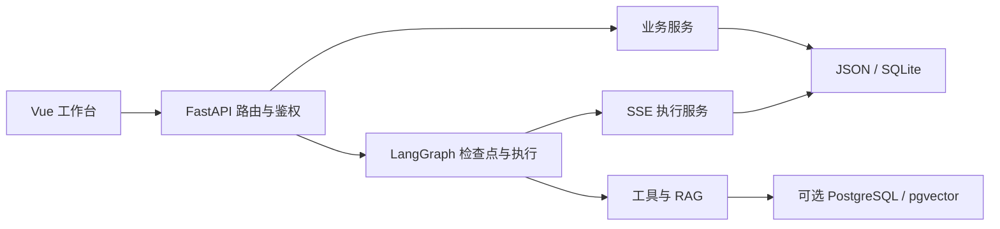

# FinSight 100轮排查与修复记录

日期：2026-11-18。基准：acadbb0；执行分支：main。

范围：用户授权100轮证据驱动排查，每个真实缺陷先复现，再最小修复、验证；全部结束后统一push。这里一轮指一个独立风险契约的源码核对与测试证据复核；多个契约共享一次测试集合执行。100轮不代表100个缺陷、100次测试启动或100个提交。

结果：4轮复现并修复缺陷，96轮在所列源码与测试范围内未复现新缺陷。未新增依赖，未重构，未修改前端；4个完整修复提交，另用一个文档提交保存本台账。所有新增回归均实际执行，未通过跳过或放宽断言绕过失败。

## 架构与最危险的三类债务

- 入口与依赖方向：frontend-vue/src/router/index.ts、frontend-vue/src/api/client.ts → backend/api/main.py → backend/services 或 backend/graph/runner.py。图执行、SSE、报告落盘由 backend/services/execution_service.py 编排；身份在网关解析，服务以 user/session 隔离数据。
- 用户数据恢复链缺口：提醒历史中非法时间戳会被TTL裁剪并覆盖原文件。证据见第1轮。优先修这项，因为它会不可逆地丢失原始事件；最小修复仅检查解析结果是否为空，接入现有备份/告警路径。
- 真实接口与测试替身漂移：笔记调用 embed_texts，但真实 EmbeddingService 提供 encode；错误被降级吞没。证据见第2轮，真实服务测试与SQLite端到端回归共同验证。
- 异步路由混入同步IO：笔记路由在async函数直接执行SQLite、嵌入与文件访问；300ms注入延迟使并发轻量ASGI探针约309ms才响应。证据见第3轮；普通同步路由交给FastAPI线程池，上传查询用asyncio.to_thread。

第4轮补齐第2类债务的失败可观测性：vectorize_note返回False时也留warning，不丢弃已保存笔记。

## 实际验证记录

- B：CI Stage 2后端集合，本地Windows：`.venv/Scripts/python.exe -m pytest -q backend/tests tests/rag_quality/test_rag_quality.py tests/regression/test_mock_tools_contract.py tests/unit/test_trace_emitter.py --tb=short -r s`，子进程`RAG_EMBEDDING=hash`；8440 passed、2 skipped、13 warnings，693.16秒。执行树为3676731（前三项修复后）。
- N：第4项修复后，test_research_notes、test_notes_rag、test_research_notes_router、test_phase9_notes_smoke、test_strict_json_boundaries、test_sqlite_conn_context_closes：168 passed，8.22秒。包含第4项全部4个新增用例，并回归前三项中的笔记路径。
- R：CI Stage 3集合：tests/retrieval_eval/test_retrieval_eval_runner.py、tests/rag_qualityV2：31 passed，0.91秒，0 skip。
- 2项既有跳过已核对源码：backend/tests/test_conversation_experience.py:14明确退役旧ConversationAgent；backend/tests/test_streaming.py为需要运行后端服务器的手工集成。它们不承担本次修复覆盖。
- B中的warnings主要为第三方弃用，以及极端数值回归刻意触发的NumPy/Pandas溢出；相关断言通过。
- 第4项修改属于两处warning调用，按受影响范围跑N；没有把B写成最终树全量重跑结果。以下B所涉及的其他模块在B之后未改动。
- 差异检查：git diff --check通过；只修改8个修复/回归文件及本台账。远程fetch后origin/main无新增提交，本地4个修复提交领先。

## 逐轮证据

“未复现”仅表示所列契约在本地证据范围内成立，不等同于模块无其他缺陷。源码链接定位契约实现；测试链接定位关键回归，其完整测试文件包含在B/N/R所列集合中。

| 轮次 | 检查目标 | 源码证据 | 测试证据 | 结论与验证 |
| --- | --- | --- | --- | --- |
| 1 | 提醒坏时间戳被裁剪覆盖 | [backend/services/subscription_service.py:179](../../backend/services/subscription_service.py#L179) | [backend/tests/test_subscription_security.py:934](../../backend/tests/test_subscription_security.py#L934) | 旧代码7项失败；修后349项通过；0274bb7 |
| 2 | 笔记嵌入接口不存在 | [backend/services/notes_rag.py:86](../../backend/services/notes_rag.py#L86) | [backend/tests/test_notes_rag.py:50](../../backend/tests/test_notes_rag.py#L50) | 真实服务与隔离roundtrip旧代码2项失败；修后168项通过；96b72b7 |
| 3 | 笔记IO阻塞事件循环 | [backend/api/research_notes_router.py:70](../../backend/api/research_notes_router.py#L70) | [backend/tests/test_research_notes_router.py:31](../../backend/tests/test_research_notes_router.py#L31) | ASGI线程断言旧代码7项失败；修后122项通过；3676731 |
| 4 | 向量化False没有警告 | [backend/services/research_notes.py:143](../../backend/services/research_notes.py#L143) | [backend/tests/test_research_notes.py:13](../../backend/tests/test_research_notes.py#L13) | 旧代码2项失败、2项成功对照通过；修后168项通过；c623df8 |
| 5 | 聊天跨实例更新 | [backend/services/chat_history.py:82](../../backend/services/chat_history.py#L82) | [backend/tests/test_chat_history_store.py:160](../../backend/tests/test_chat_history_store.py#L160) | 未复现新缺陷；共用模块锁覆盖读改写；B通过 |
| 6 | 聊天损坏恢复 | [backend/services/chat_history.py:145](../../backend/services/chat_history.py#L145) | [backend/tests/test_chat_history_store.py:78](../../backend/tests/test_chat_history_store.py#L78) | 未复现新缺陷；备份成功后才回退；B通过 |
| 7 | 会话文件名碰撞 | [backend/services/chat_history.py:38](../../backend/services/chat_history.py#L38) | [backend/tests/test_chat_history_store.py:59](../../backend/tests/test_chat_history_store.py#L59) | 未复现新缺陷；原始会话摘要区分清洗后同名；B通过 |
| 8 | 聊天证据边界 | [backend/services/chat_history.py:52](../../backend/services/chat_history.py#L52) | [backend/tests/test_chat_history_store.py:146](../../backend/tests/test_chat_history_store.py#L146) | 未复现新缺陷；严格JSON与64KiB上限；B通过 |
| 9 | 画像损坏保护 | [backend/services/memory.py:143](../../backend/services/memory.py#L143) | [backend/tests/test_memory.py:100](../../backend/tests/test_memory.py#L100) | 未复现新缺陷；损坏文件保留备份；B通过 |
| 10 | 画像身份覆盖 | [backend/services/memory.py:143](../../backend/services/memory.py#L143) | [backend/tests/test_memory.py:140](../../backend/tests/test_memory.py#L140) | 未复现新缺陷；落盘身份不能替换请求身份；B通过 |
| 11 | 关注列表并发 | [backend/services/memory.py:220](../../backend/services/memory.py#L220) | [backend/tests/test_memory.py:185](../../backend/tests/test_memory.py#L185) | 未复现新缺陷；模块锁保护增量更新；B通过 |
| 12 | 关注配额边界 | [backend/services/memory.py:220](../../backend/services/memory.py#L220) | [backend/tests/test_memory.py:204](../../backend/tests/test_memory.py#L204) | 未复现新缺陷；重复更新不占新配额；B通过 |
| 13 | 套餐跨实例更新 | [backend/services/entitlements.py:218](../../backend/services/entitlements.py#L218) | [backend/tests/test_entitlements.py:95](../../backend/tests/test_entitlements.py#L95) | 未复现新缺陷；加锁后重读当前文件；B通过 |
| 14 | 套餐损坏保护 | [backend/services/entitlements.py:158](../../backend/services/entitlements.py#L158) | [backend/tests/test_entitlements.py:120](../../backend/tests/test_entitlements.py#L120) | 未复现新缺陷；坏形状与非有限值备份；B通过 |
| 15 | 订阅并发落盘 | [backend/services/subscription_service.py:199](../../backend/services/subscription_service.py#L199) | [backend/tests/test_persistence_concurrency.py:6](../../backend/tests/test_persistence_concurrency.py#L6) | 未复现新缺陷；同目录临时文件原子替换；B通过 |
| 16 | 组合批量事务 | [backend/services/portfolio_store.py:232](../../backend/services/portfolio_store.py#L232) | [backend/tests/test_persistence_concurrency.py:28](../../backend/tests/test_persistence_concurrency.py#L28) | 未复现新缺陷；SQLite即时事务与模块锁；B通过 |
| 17 | 组合坏行读取 | [backend/services/portfolio_store.py:140](../../backend/services/portfolio_store.py#L140) | [backend/tests/test_portfolio_invalid_stored_rows.py:26](../../backend/tests/test_portfolio_invalid_stored_rows.py#L26) | 未复现新缺陷；无效存量数值有读取保护；B通过 |
| 18 | 报告跨实例并发 | [backend/services/report_index.py:124](../../backend/services/report_index.py#L124) | [backend/tests/test_report_index_concurrency.py:38](../../backend/tests/test_report_index_concurrency.py#L38) | 未复现新缺陷；多个存储实例共享锁；B通过 |
| 19 | 报告回滚失败保护 | [scripts/report_index_rollback.py:39](../../scripts/report_index_rollback.py#L39) | [backend/tests/test_report_index_rollback.py:36](../../backend/tests/test_report_index_rollback.py#L36) | 未复现新缺陷；回滚写入失败保留原库；B通过 |
| 20 | 风险快照并发 | [backend/services/risk_snapshots.py:37](../../backend/services/risk_snapshots.py#L37) | [backend/tests/test_risk_snapshots_concurrency.py:35](../../backend/tests/test_risk_snapshots_concurrency.py#L35) | 未复现新缺陷；模块锁与WAL；B通过 |
| 21 | 风险坏快照读取 | [backend/services/risk_snapshots.py:240](../../backend/services/risk_snapshots.py#L240) | [backend/tests/test_risk_snapshots.py:360](../../backend/tests/test_risk_snapshots.py#L360) | 未复现新缺陷；读取严格JSON并排除降级数据；B通过 |
| 22 | 监控并发读写 | [backend/services/monitoring_storage.py:36](../../backend/services/monitoring_storage.py#L36) | [backend/tests/test_monitoring_storage_concurrency.py:38](../../backend/tests/test_monitoring_storage_concurrency.py#L38) | 未复现新缺陷；WAL及busy timeout；B通过 |
| 23 | 历史批量事务 | [backend/services/historical_data_store.py:277](../../backend/services/historical_data_store.py#L277) | [backend/tests/test_historical_data_store.py:106](../../backend/tests/test_historical_data_store.py#L106) | 未复现新缺陷；失败回滚整批；B通过 |
| 24 | 历史标的污染 | [backend/services/historical_data_store.py:335](../../backend/services/historical_data_store.py#L335) | [backend/tests/test_historical_data_store.py:24](../../backend/tests/test_historical_data_store.py#L24) | 未复现新缺陷；失败回退不能污染缓存；B通过 |
| 25 | 复权缓存有效期 | [backend/services/historical_data_store.py:232](../../backend/services/historical_data_store.py#L232) | [backend/tests/test_historical_data_store.py:481](../../backend/tests/test_historical_data_store.py#L481) | 未复现新缺陷；局部刷新不掩盖过期区段；B通过 |
| 26 | 图片并发配额 | [backend/services/note_images.py:78](../../backend/services/note_images.py#L78) | [backend/tests/test_note_images.py:134](../../backend/tests/test_note_images.py#L134) | 未复现新缺陷；计数和写盘共用锁；B通过 |
| 27 | 图片类型伪造 | [backend/services/note_images.py:78](../../backend/services/note_images.py#L78) | [backend/tests/test_note_images.py:97](../../backend/tests/test_note_images.py#L97) | 未复现新缺陷；校验内容签名；B通过 |
| 28 | 图片Windows路径 | [backend/services/note_images.py:52](../../backend/services/note_images.py#L52) | [backend/tests/test_note_images.py:173](../../backend/tests/test_note_images.py#L173) | 未复现新缺陷；拒绝别名与穿越字符；B通过 |
| 29 | SQLite句柄关闭 | [backend/services/research_notes.py:79](../../backend/services/research_notes.py#L79) | [backend/tests/test_sqlite_conn_context_closes.py:44](../../backend/tests/test_sqlite_conn_context_closes.py#L44) | 未复现新缺陷；异常回滚且finally关闭；B通过 |
| 30 | 密钥常量时间比较 | [backend/security/auth.py:87](../../backend/security/auth.py#L87) | [backend/tests/test_auth_principal.py:6](../../backend/tests/test_auth_principal.py#L6) | 未复现新缺陷；逐候选恒时比较；B通过 |
| 31 | Principal存储身份 | [backend/security/auth.py:94](../../backend/security/auth.py#L94) | [backend/tests/test_auth_principal.py:41](../../backend/tests/test_auth_principal.py#L41) | 未复现新缺陷；规范化用户标识；B通过 |
| 32 | 跨用户身份伪造 | [backend/security/auth.py:149](../../backend/security/auth.py#L149) | [backend/tests/test_auth_principal.py:70](../../backend/tests/test_auth_principal.py#L70) | 未复现新缺陷；服务入口校验用户会话邮箱归属；B通过 |
| 33 | 普通Key管理员权限 | [backend/security/auth.py:94](../../backend/security/auth.py#L94) | [backend/tests/test_principal_admin_default.py:13](../../backend/tests/test_principal_admin_default.py#L13) | 未复现新缺陷；管理员需显式映射；B通过 |
| 34 | 开发登录暴露 | [backend/api/auth_router.py:44](../../backend/api/auth_router.py#L44) | [backend/tests/test_auth_router_security.py:15](../../backend/tests/test_auth_router_security.py#L15) | 未复现新缺陷；非开发环境隐藏mock登录；B通过 |
| 35 | 登录输入限额 | [backend/api/auth_router.py:44](../../backend/api/auth_router.py#L44) | [backend/tests/test_auth_router_security.py:54](../../backend/tests/test_auth_router_security.py#L54) | 未复现新缺陷；哈希前拒绝超大输入；B通过 |
| 36 | 生产密钥门禁 | [backend/api/security_config.py:131](../../backend/api/security_config.py#L131) | [backend/tests/test_security_gate_auth_rate_limit.py:113](../../backend/tests/test_security_gate_auth_rate_limit.py#L113) | 未复现新缺陷；生产缺失或弱密钥拒启；B通过 |
| 37 | 公开路径边界 | [backend/api/security_config.py:102](../../backend/api/security_config.py#L102) | [backend/tests/test_security_gate_auth_rate_limit.py:183](../../backend/tests/test_security_gate_auth_rate_limit.py#L183) | 未复现新缺陷；默认dashboard仍需认证；B通过 |
| 38 | CORS预检 | [backend/api/main.py:461](../../backend/api/main.py#L461) | [backend/tests/test_cors_preflight.py:26](../../backend/tests/test_cors_preflight.py#L26) | 未复现新缺陷；预检遵循配置并返回CORS头；B通过 |
| 39 | API限流 | [backend/api/security_config.py:185](../../backend/api/security_config.py#L185) | [backend/tests/test_security_gate_auth_rate_limit.py:210](../../backend/tests/test_security_gate_auth_rate_limit.py#L210) | 未复现新缺陷；达到限额返回429；B通过 |
| 40 | 套餐功能授权 | [backend/services/entitlements.py:246](../../backend/services/entitlements.py#L246) | [backend/tests/test_entitlements_enforcement.py:29](../../backend/tests/test_entitlements_enforcement.py#L29) | 未复现新缺陷；免费/付费/管理员分别判权；B通过 |
| 41 | 使用量计数 | [backend/services/entitlements.py:332](../../backend/services/entitlements.py#L332) | [backend/tests/test_entitlements_usage.py:105](../../backend/tests/test_entitlements_usage.py#L105) | 未复现新缺陷；使用量视图按额度与计数生成；B通过 |
| 42 | 配置原子写 | [backend/api/config_router.py:194](../../backend/api/config_router.py#L194) | [backend/tests/test_config_router_secret_merge.py:48](../../backend/tests/test_config_router_secret_merge.py#L48) | 未复现新缺陷；配置更新原子替换；B通过 |
| 43 | 配置损坏备份 | [backend/api/config_router.py:145](../../backend/api/config_router.py#L145) | [backend/tests/test_config_router_secret_merge.py:145](../../backend/tests/test_config_router_secret_merge.py#L145) | 未复现新缺陷；覆盖前保留原配置；B通过 |
| 44 | 配置脱敏回传 | [backend/api/config_router.py:96](../../backend/api/config_router.py#L96) | [backend/tests/test_config_router_secret_merge.py:20](../../backend/tests/test_config_router_secret_merge.py#L20) | 未复现新缺陷；掩码不覆盖真实密钥；B通过 |
| 45 | RAG原文管理员边界 | [backend/api/auth_identity.py:79](../../backend/api/auth_identity.py#L79) | [backend/tests/test_rag_observability_auth.py:147](../../backend/tests/test_rag_observability_auth.py#L147) | 未复现新缺陷；普通API key不自动升内部权限；B通过 |
| 46 | RAG集合过滤 | [backend/rag/observability_runtime.py:314](../../backend/rag/observability_runtime.py#L314) | [backend/tests/test_rag_observability_collection_filter.py:46](../../backend/tests/test_rag_observability_collection_filter.py#L46) | 未复现新缺陷；collection谓词先于LIMIT执行，避免空页；B通过 |
| 47 | Trace敏感字段 | [backend/api/main.py:213](../../backend/api/main.py#L213) | [backend/tests/test_trace_and_session_security.py:70](../../backend/tests/test_trace_and_session_security.py#L70) | 未复现新缺陷；敏感payload遮盖；B通过 |
| 48 | Session单调时间 | [backend/api/session_context.py:125](../../backend/api/session_context.py#L125) | [backend/tests/test_trace_and_session_security.py:124](../../backend/tests/test_trace_and_session_security.py#L124) | 未复现新缺陷；TTL不受墙钟跳变；B通过 |
| 49 | SSRF连接固定 | [backend/security/pinned_http.py:99](../../backend/security/pinned_http.py#L99) | [backend/tests/test_ssrf_pinning.py:105](../../backend/tests/test_ssrf_pinning.py#L105) | 未复现新缺陷；连接使用验证后的IP；B通过 |
| 50 | 重定向凭证隔离 | [backend/security/pinned_http.py:99](../../backend/security/pinned_http.py#L99) | [backend/tests/test_ssrf_pinning.py:161](../../backend/tests/test_ssrf_pinning.py#L161) | 未复现新缺陷；跨源重定向移除凭证；B通过 |
| 51 | 私网SSRF拒绝 | [backend/security/ssrf.py:48](../../backend/security/ssrf.py#L48) | [backend/tests/test_deep_search_ssrf.py:5](../../backend/tests/test_deep_search_ssrf.py#L5) | 未复现新缺陷；拒绝localhost与非HTTP；B通过 |
| 52 | PDF客户端标记 | [backend/services/pdf_export.py:165](../../backend/services/pdf_export.py#L165) | [backend/tests/test_pdf_export_security.py:18](../../backend/tests/test_pdf_export_security.py#L18) | 未复现新缺陷；转义客户端ReportLab标记；B通过 |
| 53 | 路由内部错误脱敏 | [backend/api/chat_router.py:61](../../backend/api/chat_router.py#L61) | [backend/tests/test_router_value_error_contract.py:95](../../backend/tests/test_router_value_error_contract.py#L95) | 未复现新缺陷；客户端参数错误用422，内部错误500，响应与日志不泄露细节；B通过 |
| 54 | Web日志凭证 | [backend/tools/web.py:20](../../backend/tools/web.py#L20) | [backend/tests/test_web_tool_security.py:17](../../backend/tests/test_web_tool_security.py#L17) | 未复现新缺陷；查询凭证不进日志；B通过 |
| 55 | 执行同会话串行 | [backend/services/execution_helpers.py:45](../../backend/services/execution_helpers.py#L45) | [backend/tests/test_execution_thread_lock.py:75](../../backend/tests/test_execution_thread_lock.py#L75) | 未复现新缺陷；同一会话请求持同一执行锁；B通过 |
| 56 | 执行超时取消 | [backend/services/execution_service.py:54](../../backend/services/execution_service.py#L54) | [backend/tests/test_execution_thread_lock.py:270](../../backend/tests/test_execution_thread_lock.py#L270) | 未复现新缺陷；超时取消图且释放锁；B通过 |
| 57 | 执行错误释放锁 | [backend/services/execution_service.py:54](../../backend/services/execution_service.py#L54) | [backend/tests/test_execution_thread_lock.py:244](../../backend/tests/test_execution_thread_lock.py#L244) | 未复现新缺陷；异常路径允许后续请求；B通过 |
| 58 | 流式datetime序列化 | [backend/api/chat_router.py:270](../../backend/api/chat_router.py#L270) | [backend/tests/test_streaming_datetime_serialization.py:22](../../backend/tests/test_streaming_datetime_serialization.py#L22) | 未复现新缺陷；SSE载荷含datetime仍可JSON序列化；B通过 |
| 59 | 阶段事件契约 | [backend/services/execution_service.py:54](../../backend/services/execution_service.py#L54) | [backend/tests/test_execution_stage_events.py:51](../../backend/tests/test_execution_stage_events.py#L51) | 未复现新缺陷；图阶段事件与响应匹配；B通过 |
| 60 | 执行质量门禁 | [backend/services/execution_helpers.py:110](../../backend/services/execution_helpers.py#L110) | [backend/tests/test_execution_quality_gate.py:19](../../backend/tests/test_execution_quality_gate.py#L19) | 未复现新缺陷；低质报告输出标记受约束；B通过 |
| 61 | 执行证据新鲜度 | [backend/services/execution_helpers.py:23](../../backend/services/execution_helpers.py#L23) | [backend/tests/test_execution_freshness.py:16](../../backend/tests/test_execution_freshness.py#L16) | 未复现新缺陷；模拟/实时新鲜度显式标注；B通过 |
| 62 | 确认意图否定 | [backend/graph/nodes/confirmation_gate.py:132](../../backend/graph/nodes/confirmation_gate.py#L132) | [backend/tests/test_confirmation_gate_policy.py:150](../../backend/tests/test_confirmation_gate_policy.py#L150) | 未复现新缺陷；否定语句不能误批准；B通过 |
| 63 | 确认续跑隔离 | [backend/graph/nodes/confirmation_gate.py:177](../../backend/graph/nodes/confirmation_gate.py#L177) | [backend/tests/test_confirmation_resume_routing.py:98](../../backend/tests/test_confirmation_resume_routing.py#L98) | 未复现新缺陷；未批准检查点继续暂停；B通过 |
| 64 | 执行计划依赖 | [backend/graph/executor.py:117](../../backend/graph/executor.py#L117) | [backend/tests/test_executor.py:55](../../backend/tests/test_executor.py#L55) | 未复现新缺陷；分组依赖与结果cache受测试约束；B通过 |
| 65 | 执行失败兄弟任务 | [backend/graph/executor.py:117](../../backend/graph/executor.py#L117) | [backend/tests/test_executor.py:140](../../backend/tests/test_executor.py#L140) | 未复现新缺陷；失败路径取消并排空并行任务；B通过 |
| 66 | LangChain工具错误脱敏 | [backend/langchain_tools.py:295](../../backend/langchain_tools.py#L295) | [backend/tests/test_langchain_tool_error_contract.py:26](../../backend/tests/test_langchain_tool_error_contract.py#L26) | 未复现新缺陷；包装器保留错误状态且移除内部细节；B通过 |
| 67 | Agent适配恢复 | [backend/graph/adapters/agent_adapter.py:169](../../backend/graph/adapters/agent_adapter.py#L169) | [backend/tests/test_agent_adapter_resilience.py:13](../../backend/tests/test_agent_adapter_resilience.py#L13) | 未复现新缺陷；agent异常明确降级；B通过 |
| 68 | IR结构校验 | [backend/graph/plan_ir.py:74](../../backend/graph/plan_ir.py#L74) | [backend/tests/test_plan_ir_validation.py:34](../../backend/tests/test_plan_ir_validation.py#L34) | 未复现新缺陷；非法IR拒绝；B通过 |
| 69 | 政策工具选择 | [backend/graph/nodes/policy_gate.py:223](../../backend/graph/nodes/policy_gate.py#L223) | [backend/tests/test_policy_gate.py:5](../../backend/tests/test_policy_gate.py#L5) | 未复现新缺陷；工具授权与市场规则约束；B通过 |
| 70 | 规划分析深度约束 | [backend/graph/nodes/planner_policy.py:217](../../backend/graph/nodes/planner_policy.py#L217) | [backend/tests/test_planner_constraints.py:65](../../backend/tests/test_planner_constraints.py#L65) | 未复现新缺陷；report深度不擅自启用deep_search；B通过 |
| 71 | 消息裁剪完整性 | [backend/graph/nodes/trim_conversation_history.py:59](../../backend/graph/nodes/trim_conversation_history.py#L59) | [backend/tests/test_trim_conversation_history.py:33](../../backend/tests/test_trim_conversation_history.py#L33) | 未复现新缺陷；裁剪保留合法消息关系；B通过 |
| 72 | 历史摘要保留近期消息 | [backend/graph/nodes/summarize_history.py:64](../../backend/graph/nodes/summarize_history.py#L64) | [backend/tests/test_summarize_history.py:82](../../backend/tests/test_summarize_history.py#L82) | 未复现新缺陷；摘要旧消息时保留最近消息；B通过 |
| 73 | 检查点连接生命周期 | [backend/graph/checkpointer.py:47](../../backend/graph/checkpointer.py#L47) | [backend/tests/test_graph_checkpointer.py:85](../../backend/tests/test_graph_checkpointer.py#L85) | 未复现新缺陷；连接按生命周期管理；B通过 |
| 74 | 检查点消息恢复 | [backend/graph/checkpointer.py:245](../../backend/graph/checkpointer.py#L245) | [backend/tests/test_checkpointer_messages.py:24](../../backend/tests/test_checkpointer_messages.py#L24) | 未复现新缺陷；多轮消息恢复不混会话；B通过 |
| 75 | LLM令牌桶配额 | [backend/services/rate_limiter.py:185](../../backend/services/rate_limiter.py#L185) | [backend/tests/test_rate_limiter_quota.py:182](../../backend/tests/test_rate_limiter_quota.py#L182) | 未复现新缺陷；令牌桶与保底配额按单调钟统计；B通过 |
| 76 | 数据源熔断 | [backend/services/circuit_breaker.py:71](../../backend/services/circuit_breaker.py#L71) | [backend/tests/test_circuit_breaker.py:20](../../backend/tests/test_circuit_breaker.py#L20) | 未复现新缺陷；开放/半开恢复与单调钟；B通过 |
| 77 | LLM端点轮换 | [backend/services/llm_retry.py:137](../../backend/services/llm_retry.py#L137) | [backend/tests/test_llm_rotation.py:374](../../backend/tests/test_llm_rotation.py#L374) | 未复现新缺陷；轮换遵循现有可重试状态码与端点冷却规则；B通过 |
| 78 | 缓存市场时间 | [backend/services/smart_cache.py:43](../../backend/services/smart_cache.py#L43) | [backend/tests/test_smart_cache_market.py:65](../../backend/tests/test_smart_cache_market.py#L65) | 未复现新缺陷；TTL按市场状态使用；B通过 |
| 79 | Insights异步缓存 | [backend/dashboard/insights_engine.py:63](../../backend/dashboard/insights_engine.py#L63) | [backend/tests/test_insights_loop_binding.py:22](../../backend/tests/test_insights_loop_binding.py#L22) | 未复现新缺陷；跨事件循环重建异步锁；B通过 |
| 80 | 报告复查筛选 | [backend/services/reports_to_review.py:19](../../backend/services/reports_to_review.py#L19) | [backend/tests/test_reports_to_review.py:18](../../backend/tests/test_reports_to_review.py#L18) | 未复现新缺陷；时间与状态决定复查候选；B通过 |
| 81 | 今日任务过期 | [backend/services/daily_tasks.py:45](../../backend/services/daily_tasks.py#L45) | [backend/tests/test_daily_tasks_stale.py:93](../../backend/tests/test_daily_tasks_stale.py#L93) | 未复现新缺陷；过期任务不当成当前行动；B通过 |
| 82 | 下一步行动排序 | [backend/services/next_actions.py:19](../../backend/services/next_actions.py#L19) | [backend/tests/test_next_actions.py:41](../../backend/tests/test_next_actions.py#L41) | 未复现新缺陷；候选去重排序并保持身份；B通过 |
| 83 | 报告变化检测 | [backend/services/what_changed.py:301](../../backend/services/what_changed.py#L301) | [backend/tests/test_what_changed.py:152](../../backend/tests/test_what_changed.py#L152) | 未复现新缺陷；证据缺失与变化区分；B通过 |
| 84 | 时间线笔记事件 | [backend/services/timeline_service.py:172](../../backend/services/timeline_service.py#L172) | [backend/tests/test_timeline_service.py:174](../../backend/tests/test_timeline_service.py#L174) | 未复现新缺陷；目标会话及用户笔记转换为事件；B通过 |
| 85 | 研究质量状态归一 | [backend/services/research_quality.py:339](../../backend/services/research_quality.py#L339) | [backend/tests/test_research_quality.py:94](../../backend/tests/test_research_quality.py#L94) | 未复现新缺陷；质量状态的计数与issues一致；B通过 |
| 86 | 组合风险无效持仓 | [backend/services/portfolio_risk_lens.py:32](../../backend/services/portfolio_risk_lens.py#L32) | [backend/tests/test_portfolio_risk_lens.py:252](../../backend/tests/test_portfolio_risk_lens.py#L252) | 未复现新缺陷；无效持仓不制造有效风险暴露；B通过 |
| 87 | 风险归因极端数值 | [backend/services/risk_attribution.py:104](../../backend/services/risk_attribution.py#L104) | [backend/tests/test_risk_attribution.py:221](../../backend/tests/test_risk_attribution.py#L221) | 未复现新缺陷；极端收益仍输出有限结果；B通过 |
| 88 | 组合优化平价序列 | [backend/services/portfolio_optimizer.py:26](../../backend/services/portfolio_optimizer.py#L26) | [backend/tests/test_portfolio_optimizer.py:171](../../backend/tests/test_portfolio_optimizer.py#L171) | 未复现新缺陷；常量价格不泄漏NaN；B通过 |
| 89 | 回测不完整行情 | [backend/services/backtest_engine.py:74](../../backend/services/backtest_engine.py#L74) | [backend/tests/test_backtest_engine.py:120](../../backend/tests/test_backtest_engine.py#L120) | 未复现新缺陷；日期与缺失行情校验；B通过 |
| 90 | 再平衡计算边界 | [backend/services/rebalance_engine.py:124](../../backend/services/rebalance_engine.py#L124) | [backend/tests/test_rebalance_engine.py:306](../../backend/tests/test_rebalance_engine.py#L306) | 未复现新缺陷；权重/成本/成交边界；B通过 |
| 91 | 任务集中度 | [backend/services/task_generator.py:289](../../backend/services/task_generator.py#L289) | [backend/tests/test_task_generator_concentration.py:49](../../backend/tests/test_task_generator_concentration.py#L49) | 未复现新缺陷；集中度风险任务根据真实仓位；B通过 |
| 92 | 新闻提醒标的匹配 | [backend/services/alert_scheduler.py:330](../../backend/services/alert_scheduler.py#L330) | [backend/tests/test_alert_scheduler_ticker_match.py:127](../../backend/tests/test_alert_scheduler_ticker_match.py#L127) | 未复现新缺陷；提醒新闻须匹配代码边界与显式关联标的；B通过 |
| 93 | 新闻提醒失败恢复 | [backend/services/alert_scheduler.py:330](../../backend/services/alert_scheduler.py#L330) | [backend/tests/test_news_alert_success_resets_failures.py:64](../../backend/tests/test_news_alert_success_resets_failures.py#L64) | 未复现新缺陷；成功重置连续失败；B通过 |
| 94 | 提醒周期调度 | [backend/services/scheduler_runner.py:23](../../backend/services/scheduler_runner.py#L23) | [backend/tests/test_scheduler_runner.py:18](../../backend/tests/test_scheduler_runner.py#L18) | 未复现新缺陷；关闭配置不启动调度，启用配置可执行任务；B通过 |
| 95 | 嵌入后端输出 | [backend/rag/embedder.py:239](../../backend/rag/embedder.py#L239) | [backend/tests/test_embedder.py:127](../../backend/tests/test_embedder.py#L127) | 未复现新缺陷；维度与降级输出契约；B通过 |
| 96 | Hybrid余弦边界 | [backend/rag/hybrid_service.py:69](../../backend/rag/hybrid_service.py#L69) | [backend/tests/test_hybrid_cosine.py:5](../../backend/tests/test_hybrid_cosine.py#L5) | 未复现新缺陷；不同维度不把截断内积当有效相似度；B通过 |
| 97 | 文档分块限制 | [backend/rag/chunker.py:127](../../backend/rag/chunker.py#L127) | [backend/tests/test_chunker.py:90](../../backend/tests/test_chunker.py#L90) | 未复现新缺陷；分块大小与重叠约束；B通过 |
| 98 | Rerank退化 | [backend/rag/reranker.py:135](../../backend/rag/reranker.py#L135) | [backend/tests/test_reranker.py:69](../../backend/tests/test_reranker.py#L69) | 未复现新缺陷；重排异常可回退；B通过 |
| 99 | 检索评估指标 | [tests/retrieval_eval/run_retrieval_eval.py:314](../../tests/retrieval_eval/run_retrieval_eval.py#L314) | [tests/retrieval_eval/test_retrieval_eval_runner.py:130](../../tests/retrieval_eval/test_retrieval_eval_runner.py#L130) | 未复现新缺陷；质量指标低于阈值时gate失败；R通过 |
| 100 | 检索质量V2门禁 | [tests/rag_qualityV2/engine_v2.py:459](../../tests/rag_qualityV2/engine_v2.py#L459) | [tests/rag_qualityV2/test_engine_v2.py:67](../../tests/rag_qualityV2/test_engine_v2.py#L67) | 未复现新缺陷；评估全流程及报告schema有单元覆盖；R通过 |

## 剩余风险与验证边界

- 修复前因接口错误未生成的旧笔记向量不会自动补齐；可使用现有vectorize-all接口为当前用户/会话补建。此次没有操作用户数据。
- 本地使用hash嵌入；BGE模型下载、真实付费LLM、SMTP和生产外部数据源未做端到端验证。线程池卸载不能消除底层慢IO，也不能强制取消已经开始的同步工作。
- PostgreSQL/pgvector质量门禁、浏览器E2E和Compose未在本地执行；由远程CI后续验证。不能用本地B/N/R通过宣称整条远程流水线通过。
- 持久化模块锁约束同进程；多进程JSON并发写入不由此台账保证。数据库回滚工具检查只验证失败时主库字节保留，未在运行中的生产数据库执行回滚。
- 统一push及远程HEAD核验在本台账提交后执行；最终消息报告实际push结果与远程CI状态。

